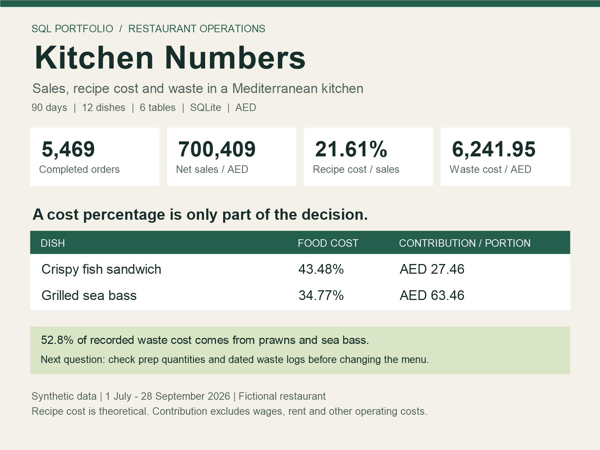

# Kitchen Numbers | SQL portfolio project

A small restaurant can sell a lot of food and still miss where ingredient costs are going. This project uses SQL to connect menu sales, recipes and recorded waste.



**Portfolio case study · fictional restaurant · synthetic data · SQLite · AED**

The setting is a casual Mediterranean kitchen in Dubai. The questions come from everyday kitchen work: what sells, what needs more prep, and which ingredients deserve closer attention?

## Start here

1. Read `docs/CASE_STUDY.md` for findings and limitations.
2. Open `kitchen.db` in a SQLite client, for example DB Browser for SQLite or DBeaver with SQLite support.
3. Open any `sql/*_analysis_*.sql` file in the SQL editor and run it. Use `01_analysis_overview.sql` first.
4. Compare your result with the matching file in `results/`.

No Python or installation of packages is needed to explore the supplied database. To rebuild it, install Python 3.10+ and run from the project folder:

```sh
python scripts/build_database.py
python scripts/run_analysis.py
```

The first command replaces only the generated `kitchen.db`, source CSVs, analysis SQL files and result files in this project. Seed 27 reproduces the dataset. The second command executes the SQL files on disk and refreshes the analysis CSVs; use it after editing a query. No credentials, internet connection or paid tools are needed.

## Scope

1 July–28 September 2026, 90 calendar days. Six tables: 20 ingredients, 12 dishes, 65 recipe components, 5,588 orders, 12,080 order lines and 542 waste entries. Of the orders, 119 are cancelled and excluded from sales.

## Questions covered

| Query | Question | SQL practice |
|---|---|---|
| 01 | How much did the kitchen sell? | COUNT DISTINCT, SUM |
| 02 | How did the months compare? | GROUP BY, date functions |
| 03 | Which dishes generated contribution? | JOIN, calculated columns |
| 04 | Is the average ticket different at lunch? | CTE, AVG |
| 05 | How does portion demand vary by weekday? | COUNT DISTINCT, ratios |
| 06 | Which ingredients cost most in waste? | JOIN, SUM |
| 07 | Which recorded waste reasons cost most? | GROUP BY |
| 08 | Which dishes exceed a 32% case-study target? | HAVING |
| 09 | How much raw stock did sold dishes require? | three-table JOIN |
| 10 | What remains after recipes and recorded waste? | CTEs, LEFT JOIN, COALESCE |
| 11 | How do sales differ by channel? | grouped aggregates |
| 12 | How does revenue accumulate? | optional window function |

## Relationships and grain

`orders` → `order_items` ← `dishes` → `recipes` ← `ingredients` → `waste`.

Every table's row meaning and units are in `docs/DATA_DICTIONARY.md`. `v_recipe_cost` contains one row per dish; `v_sales` contains one row per completed order line. Aggregate sales and waste separately before joining by date to avoid multiplying totals.

## Files

- `sql/01_schema.sql`: tables, constraints, indexes and two views.
- `sql/*_analysis_*.sql`: 12 short, individually runnable analysis queries.
- `data/`: six source CSVs with headers.
- `kitchen.db`: ready-to-query database.
- `results/`: actual query outputs, summary and validation log.
- `docs/`: case study, data dictionary, Russian walkthrough and LinkedIn draft.
- `linkedin_summary.png`: a one-page visual for a LinkedIn post.
- `scripts/`: reproducible standard-library-only database build and query runner.

## What the numbers mean

All money is AED; integer fils are stored for prices and discounts. The sales model is tax-exclusive and has no service charges, refunds, purchases, stock counts, payroll, rent or channel fees. Ingredient prices and recipes are constant throughout the period. Recipe cost is theoretical consumption, not actual COGS. Contribution after ingredients is not net profit.

Normal preparation yield loss is already included in raw recipe quantities. Logged `Prep trim` means avoidable excess trim beyond that allowance. Other waste represents separately discarded raw stock equivalents, not complete prepared dishes. This prevents the model from intentionally charging normal trim twice; real logs would need closer checking.

The 32% threshold is chosen for this exercise, not presented as a universal industry benchmark. Synthetic demand includes a Friday/Saturday uplift, more dinner orders and some lunch discounts. Patterns are design choices in simulated data, not evidence about real Dubai restaurants.

## Validation

All 12 queries have been executed. Checks cover database integrity, foreign keys, recipe coverage, complete date coverage, raw sales reconciliation, independent recipe-cost reconciliation, waste totals and running sales. See `results/validation.txt`. Rounded daily waste totals are allowed a small rounding tolerance.

## Reuse

MIT licence. All restaurant names, prices, recipes and operational records in this repository are fictional. No employer or customer data is included.
