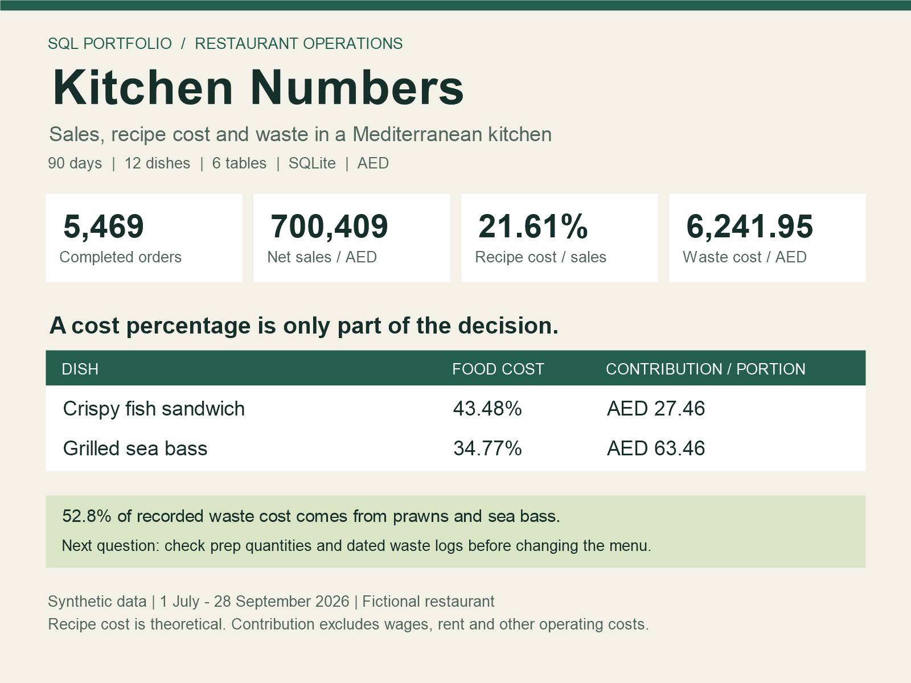

# Kitchen Numbers

I work in kitchens, so portions, prep and waste are familiar problems to me. I wanted to look at them from another angle and practise SQL using a restaurant example.

This is a case study of a fictional Mediterranean restaurant in Dubai. It connects menu sales, recipes and ingredient waste to explore where the money goes.

**The data is synthetic. No records from my employers or their customers are used.**

## What I wanted to find out

- Which dishes sell most, and which contribute most after ingredient cost?
- How does demand change across the week?
- Which ingredients account for the largest recorded waste costs?
- What does food-cost percentage leave out?

The database covers 90 days, with 12 dishes and 5,588 orders. There are 12 analysis queries, from basic totals and grouped results to joins and CTEs. An optional query uses a window function for running revenue.

## Have a look

Start with the [case study](docs/CASE_STUDY.md) for the findings.

To try the queries yourself:

1. Download or clone this repository.
2. Open `kitchen.db` in DB Browser for SQLite, or another SQLite client.
3. Run `sql/01_analysis_overview.sql`, then explore the other analysis files in `sql/`.
4. Compare the output with the CSV files in `results/`.

The database is ready to use. You only need Python if you want to rebuild the dataset.

## What is in the repo

- `kitchen.db` — the SQLite database.
- `sql/` — the schema and analysis queries.
- `data/` — source CSVs.
- `results/` — query outputs and validation results.
- `docs/` — findings, a data dictionary and a Russian walkthrough.
- `scripts/` — scripts to rebuild the database and rerun the analysis.

## A few things to keep in mind

This is a learning project, not an audit of a real restaurant. Recipe costs estimate ingredient consumption; they are not actual inventory COGS. Contribution after ingredients is not net profit: rent, payroll and other operating costs are outside the model.

The 32% food-cost target is an assumption for this exercise. Patterns in the data were simulated, so they do not tell us how Dubai restaurants perform in real life.

For dataset definitions, rebuilding instructions and the full calculation notes, see [Technical notes](TECHNICAL_NOTES.md).

## About this project

I am moving from hospitality into data analytics and learning SQL through practical cases. I use AI tools as part of that process; the queries here are examples I am working to understand and explain, rather than a claim of advanced SQL proficiency.

MIT licence. See [LICENSE](LICENSE).
